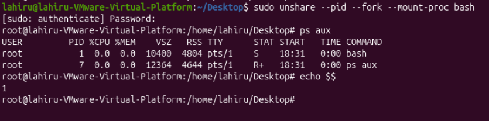
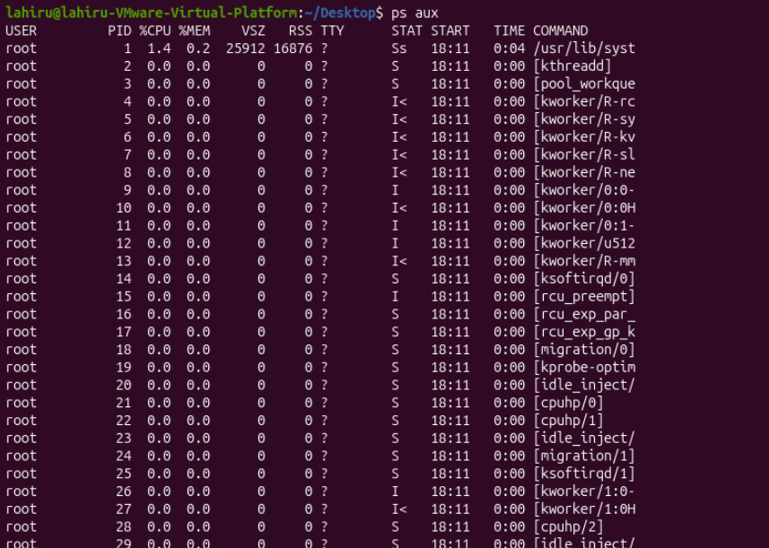

### What is container virtualization and why it's used?

Container virtualization is a type of a OS-level virtualization method that allows multiple isolated environments to run on a single operating system white sharing same OS kernel.
This technology is helped to avoid dependancy conflicts of running applications by isolating and managing their different dependecies and configurations.

Each container has it's own:
- Processes
- Network configurations
- File system
- Environment variables
- Application dependencies
However, all container share the same kernel
    
## How Does Container Isolation Work?

At its core, a container is a group of processes running in isolation.

These processes share the host operating system's kernel but have restricted and isolated views of system resources.

Linux provides a kernel feature called **Namespaces** to achieve this isolation.

Each container gets its own set of namespaces, which provide an isolated view of specific system resources.

The main Linux namespaces include:
- PID (Process ID): Isolates process IDs. Processes inside a container have their own process ID hierarchy.
- USER (User ID): Isolates user and group IDs, allowing users inside a container to have different identities from those on the host.
- UTS (Unix Time-Sharing System): Isolates hostname and domain name information.
- NET (Network): Isolates network interfaces, IP addresses, routing tables, and network settings.
- IPC (Inter-Process Communication): Isolates inter-process communication resources.
- MNT (Mount): Provides an isolated view of filesystem mount points.
- CGROUP (Control Group): Isolates the view of control group hierarchies.

These namespaces help ensure that processes inside one container have an isolated view of the system rather than directly seeing the resources of other containers.

Let's consider each namespace one by one,
# IPD

We can create a new PID namespace those processes have their own process ID hierarchy.
Try this command,

```bash
sudo unshare --pid --fork --mount-proc bash
```
Result is,


You can see the shell is running as PID 1 inside the new PID namespace. Because it has create seperate isolated processes. And numbering system is always starting from 1. 

I opened another terminal and run `ps aux`,


This figure shows running processes of the host OS.


sudo unshare --uts bash
readlink /proc/$$/ns/uts


####################################################################
1. What is Docker SWARM?
    Docker SWARM is Docker's builtin container orchestration system.

2. What problems does it solve?

Without Swarm:
- You start containers manually on each server.
- You track failures yourself.
- You balance traffic yourself.

With Swarm:
- Scaling – run many replicas of a container.
- Load balancing – distribute requests automatically.
- Self-healing – restart failed containers.
- Rolling updates – update containers with little or no downtime.
- Cluster management – manage many servers as one.    


####################################################
Lab 1: Run your first container and learn how to inspect it. Explore the Docker Hub and discover common images ready to be run.

Lab 2: Create a custom Docker Image built from a Dockerfile and push it to a central registry where it can be pulled to be deployed on other environments. Learn about the union file system and copy-on-write, and how they help you deliver applications faster.

Lab 3: Deploy containers using Docker swarm and learn how Docker Swarm helps solve problems such as reconciliation, scaling, high availability and service discovery. In this lab, you'll use Play-with-Docker for a multi-node cluster rather than use your locally installed Docker.

#####################################################